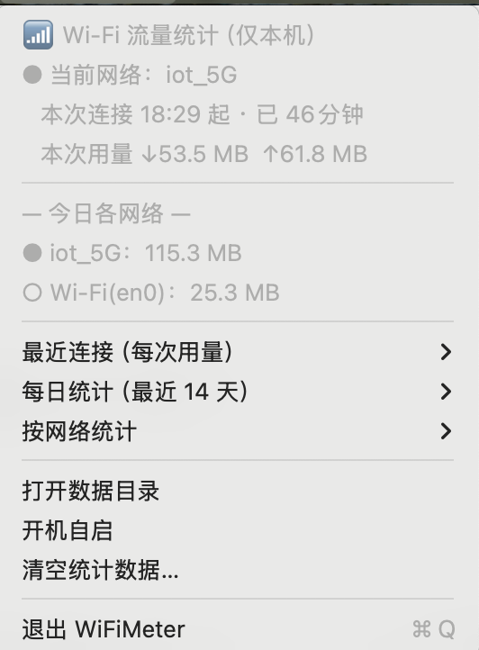

# WiFiMeter

macOS 菜单栏 Wi-Fi 流量统计工具（Swift / AppKit，原生实现，无第三方依赖，数据只存本机）。

> 仓库：[github.com/cookily/wifi-meter](https://github.com/cookily/wifi-meter) · License MIT

- **菜单栏实时显示**：当前 Wi-Fi 今日已用流量（图标旁的数字）。
- **每次用量**：一次连接 = 一段会话，记录「几点到几点、用了多少（分收/发）」；断开重连、切换网络都会分段——例如连上用了 2 GB 断开、再连用 1 GB，会看到两段记录，当日合计 3 GB。
- **每日统计**：最近 14 天每天的总用量，展开可看当天各 Wi-Fi 的分项。
- **按网络统计**：每个 Wi-Fi 的累计用量和最近 14 天走势。
- **命令行查询**：`WiFiMeter --stats` 直接在终端看统计表。

## 效果图

菜单栏常驻显示当前网络今日用量：


点开即看本次连接与各维度统计：



## 下载安装

到 [**Releases**](https://github.com/cookily/wifi-meter/releases/latest) 下载 `WiFiMeter-x.y.z.zip`，解压后把 **WiFiMeter.app** 拖入「应用程序」再打开：

- 首次打开若提示"无法验证开发者"：**右键 → 打开**，或执行 `xattr -cr /Applications/WiFiMeter.app`
- 需要 macOS 13+；建议在菜单里勾选「开机自启」

## 构建

要求 macOS 13+ 和 Xcode Command Line Tools（`xcode-select --install`）。

```bash
./scripts/make-app.sh          # swift build -c release 并打包为 build/WiFiMeter.app
open build/WiFiMeter.app       # 运行；建议拷贝到 /Applications 后再开机自启
```

调试/查看数据也可以不用界面：

```bash
swift run WiFiMeter --stats    # 终端打印统计
swift run WiFiMeter --probe    # 检查 SSID/计数器读取情况
swift run WiFiMeter --demo-menu  # 启动后自动展开菜单（截效果图用）
```

## 首次使用

1. **显示 Wi-Fi 名称需要「定位服务」权限**（macOS 11 起系统对 SSID 的限制，多数菜单栏工具相同）。未授权时统计照常进行，只是网络显示为 `Wi-Fi(en0)` 这类接口名；菜单里有「授权读取 Wi-Fi 名称」入口，点一下、在系统设置里允许即可，之后的会话就会用真实网络名。
2. 建议在菜单里勾选**开机自启**（SMAppService）。工具只统计它运行期间的流量，没运行的时段无法回溯。

## 统计口径

- 每 2 秒采样一次 `en0` 等无线网卡的字节计数器（`getifaddrs`，网卡层累计值），用相邻两次差值累加进当前会话。
- **分段规则**：连接建立→开始一段；断开（Wi-Fi 关闭/失联）或 SSID 变化→结束当前段；同一 SSID 短暂掉线重连属于两段；同一网络内漫游/换 AP 不断段。应用自身重启：同一网络且间隔 5 分钟内自动续接同一段，否则分段。
- 跨越零点的会话整体计入其**开始**那天；电脑睡眠期间不计流量。
- 计数器清零（重启/驱动重载）自动识别，不会出现负数。
- 统计的是该网卡**全部**流量：包括系统后台、局域网直传等，且为网卡层字节数（含协议开销），与运营商计费口径会有出入。VPN 流量计入物理网卡。

## 数据文件

都在 `~/Library/Application Support/WiFiMeter/`：

| 文件 | 内容 |
|---|---|
| `sessions.jsonl` | 每行一段已结束的会话：`ssid / iface / start / end / rx / tx`（ISO8601 时间，字节计数） |
| `state.json` | 进行中会话的快照与采样基线（用于崩溃/重启后续接） |

菜单里「打开数据目录」可直接定位；「清空统计数据」会删除上述文件。

## 已知限制 / Roadmap

- 不支持以太网、USB 网卡（当前只跟 Wi-Fi 网卡）。
- 无法统计工具未运行期间的流量。
- 计划中：CSV 导出、月度汇总、每日用量提醒阈值。

## License

MIT
